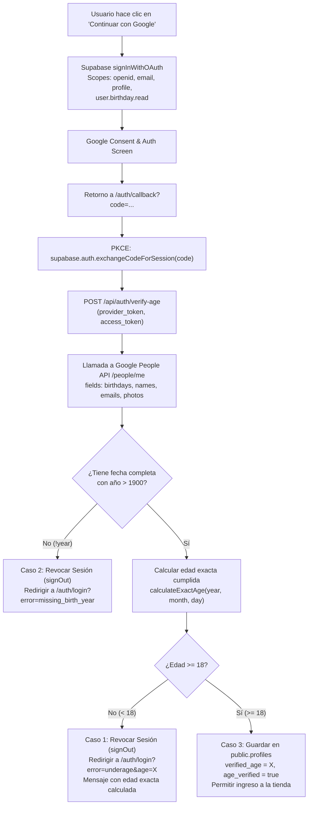

# Arquitectura de Autenticación Google OAuth 2.0 y Validación de Mayoría de Edad (+18)

**Proyecto:** Lumina Home  
**Rol:** Senior Backend Architect & Cybersecurity Specialist  
**Objetivo:** Integración blindada de inicio de sesión con Google OAuth 2.0, validación estricta de mayoría de edad (+18 años) mediante Google People API, mitigación de vulnerabilidades (Open Redirect, Race Conditions, Session Hijacking) y persistencia segura en Supabase con PostgreSQL Engine Constraints y Row Level Security (RLS).

---

## 1. Resumen de Archivos Creados y Modificados

| Archivo | Tipo | Descripción |
| :--- | :--- | :--- |
| `src/app/auth/login/page.tsx` | UI / Cliente | Reemplazo de *"Continuar sin cuenta (Explorar tienda)"* por el botón oficial **"Continuar con Google"**. Prevención de race conditions (disabled + spinner), solicitud de scope de cumpleaños, y renderizado de alertas estilizadas para casos de menores de edad o cuentas sin año de nacimiento. |
| `src/app/auth/register/page.tsx` | UI / Cliente | Reemplazo del botón de exploración invitado por el botón oficial de Google OAuth para mantener la coherencia en todo el embudo de autenticación. |
| `src/app/auth/callback/page.tsx` | Callback / PKCE | Controlador post-login que realiza el intercambio seguro de sesión (`exchangeCodeForSession` con PKCE), invoca la verificación de edad en el backend, revoca inmediatamente la sesión (`signOut`) en caso de incumplimiento de edad, y sanitiza redirecciones contra Open Redirects. |
| `src/app/api/auth/verify-age/route.ts` | Backend Route Handler | Endpoint de alta seguridad que consume Google People API (`people.googleapis.com/v1/people/me?personFields=birthdays,names,emailAddresses,photos`) con el `provider_token`, calcula la edad exacta cumplida a la fecha actual y persiste perfiles aprobados en Supabase. |
| `supabase/migrations/20261018_profiles_age_verification_18plus.sql` | Migración SQL | Esquema para `public.profiles` con `CONSTRAINT check_minimum_age_18 CHECK (verified_age IS NULL OR verified_age >= 18)`, RLS habilitado y políticas restrictivas por usuario con `SECURITY DEFINER SET search_path = public`. |

---

## 2. Flujo de Control y Reglas Estrictas de Edad (+18)



### Casos de Validación:
1. **Caso 1 — Menor de 18 años (`edad < 18`):**
   - La sesión se destruye en el acto (`await supabase.auth.signOut()`).
   - Los tokens de sesión se invalidan y el usuario es redirigido a `/auth/login?error=underage&age=${edad}`.
   - En la UI se muestra un banner de alerta con fondo rojo carmesí:
     > *"No puedes acceder por ser menor de edad (tienes ${edadCalculada} años). El acceso es exclusivo para mayores de 18 años."*
2. **Caso 2 — Cuenta Google sin año de nacimiento (`!year`):**
   - La sesión se destruye inmediatamente (`await supabase.auth.signOut()`).
   - El usuario es redirigido a `/auth/login?error=missing_birth_year`.
   - La UI informa que para ingresar mediante Google es obligatorio tener configurada una fecha de nacimiento completa (día, mes y año) en la cuenta de Google para validar la mayoría de edad.
3. **Caso 3 — Mayor o igual a 18 años (`edad >= 18`):**
   - El backend registra la edad validada en `public.profiles` (`verified_age`, `age_verified = true`, `birth_date = YYYY-MM-DD`).
   - También sincroniza el perfil en `public.user_profiles` para total compatibilidad con el carrito, pedidos y favoritos.
   - Redirección limpia al destino solicitado (`next`), sanitizado contra ataques Open Redirect.

---

## 3. Mitigaciones de Ciberseguridad Implementadas

1. **Defensa contra Open Redirect (CWE-601):**
   - La función `sanitizeRedirectPath(next)` analiza exhaustivamente la URL de redirección.
   - Solo se permiten rutas que comiencen con una sola barra `/`, bloqueando esquemas absolutos (`http:`, `https:`), barras dobles protocol-relative (`//evil.com`) y barras invertidas (`\\`).
2. **Defensa contra Race Conditions y Clics Múltiples:**
   - Al pulsar *"Continuar con Google"*, el botón pasa inmediatamente a estado `disabled`, cambia su opacidad y despliega un spinner activo con texto dinámico *"Conectando con Google..."*.
3. **Integridad del Carrito de Compras (Zero Data Loss):**
   - El carrito de compras (`useCartStore`) persiste en `localStorage` bajo la clave del carrito de invitado y se fusiona automáticamente al detectar la sesión autenticada. La navegación a Google OAuth no borra los datos locales.
4. **Protección a Nivel de Motor PostgreSQL (Check Constraints & RLS):**
   - La tabla `public.profiles` cuenta con una restricción `CONSTRAINT check_minimum_age_18 CHECK (verified_age IS NULL OR verified_age >= 18)`. Cualquier intento de insertar un registro con `verified_age < 18` es rechazado a nivel de base de datos.
   - Row Level Security (RLS) activo garantiza que los usuarios solo puedan leer o actualizar sus propios datos si cumplen el criterio de mayoría de edad.

---

## 4. Guía de Configuración en Google Cloud Console

Para que el scope de cumpleaños funcione en producción y desarrollo:

1. **Acceder a [Google Cloud Console](https://console.cloud.google.com/):**
   - Selecciona o crea el proyecto de Google Cloud para Lumina Home.
2. **Habilitar Google People API:**
   - Ve a **APIs y Servicios** > **Biblioteca**.
   - Busca **"Google People API"** y haz clic en **Habilitar**.
3. **Configurar Pantalla de Consentimiento OAuth (OAuth consent screen):**
   - Tipo de usuario: **Externo**.
   - Nombre de la app: `Lumina Home`.
   - En el paso **Permisos (Scopes)**, haz clic en **Agregar o quitar permisos** y añade:
     - `openid`
     - `https://www.googleapis.com/auth/userinfo.email`
     - `https://www.googleapis.com/auth/userinfo.profile`
     - `https://www.googleapis.com/auth/user.birthday.read` *(Fecha de nacimiento)*
   - Guarda los cambios. (Si la app está en modo "Prueba", agrega tus correos de prueba en la lista de usuarios de prueba).
4. **Credenciales OAuth 2.0:**
   - Ve a **Credenciales** > **Crear Credenciales** > **ID de cliente de OAuth**.
   - Tipo: **Aplicación web**.
   - **Orígenes de JavaScript autorizados:**
     - `http://localhost:3000`
     - `https://luminahome-3rick.vercel.app`
     - Tu dominio de Supabase: `https://<tu-proyecto-ref>.supabase.co`
   - **URI de redireccionamiento autorizados:**
     - `https://<tu-proyecto-ref>.supabase.co/auth/v1/callback`
   - Copia el **Client ID** y el **Client Secret**.

---

## 5. Guía de Configuración en Supabase Dashboard

1. Ingresa a tu panel de Supabase en [supabase.com](https://supabase.com).
2. Selecciona el proyecto **Lumina Home**.
3. Ve a **Authentication** > **Providers** > **Google**.
4. Activa el toggle **"Enable Google provider"**.
5. Pega tu **Client ID** y **Client Secret** obtenidos de Google Cloud.
6. En **Authorized Client IDs**, puedes dejar el Client ID principal.
7. Guarda los cambios.

---

## 6. Script SQL de Migración para Supabase (Listo para Copiar y Pegar)

Pega el siguiente bloque SQL directamente en el **SQL Editor** de Supabase y presiona **Run**:

```sql
-- ==============================================================================
-- Migración: Lumina Home - Perfiles con Verificación de Edad +18
-- ==============================================================================

-- 1. Crear o asegurar tabla public.profiles
CREATE TABLE IF NOT EXISTS public.profiles (
  id UUID REFERENCES auth.users(id) ON DELETE CASCADE PRIMARY KEY,
  email TEXT,
  full_name TEXT,
  avatar_url TEXT,
  birth_date DATE,
  verified_age INT,
  age_verified BOOLEAN DEFAULT false,
  updated_at TIMESTAMPTZ DEFAULT now()
);

-- 2. Asegurar columnas de manera idempotente
DO $$ 
BEGIN
  IF NOT EXISTS (SELECT 1 FROM information_schema.columns WHERE table_schema = 'public' AND table_name = 'profiles' AND column_name = 'email') THEN
    ALTER TABLE public.profiles ADD COLUMN email TEXT;
  END IF;

  IF NOT EXISTS (SELECT 1 FROM information_schema.columns WHERE table_schema = 'public' AND table_name = 'profiles' AND column_name = 'full_name') THEN
    ALTER TABLE public.profiles ADD COLUMN full_name TEXT;
  END IF;

  IF NOT EXISTS (SELECT 1 FROM information_schema.columns WHERE table_schema = 'public' AND table_name = 'profiles' AND column_name = 'avatar_url') THEN
    ALTER TABLE public.profiles ADD COLUMN avatar_url TEXT;
  END IF;

  IF NOT EXISTS (SELECT 1 FROM information_schema.columns WHERE table_schema = 'public' AND table_name = 'profiles' AND column_name = 'birth_date') THEN
    ALTER TABLE public.profiles ADD COLUMN birth_date DATE;
  END IF;

  IF NOT EXISTS (SELECT 1 FROM information_schema.columns WHERE table_schema = 'public' AND table_name = 'profiles' AND column_name = 'verified_age') THEN
    ALTER TABLE public.profiles ADD COLUMN verified_age INT;
  END IF;

  IF NOT EXISTS (SELECT 1 FROM information_schema.columns WHERE table_schema = 'public' AND table_name = 'profiles' AND column_name = 'age_verified') THEN
    ALTER TABLE public.profiles ADD COLUMN age_verified BOOLEAN DEFAULT false;
  END IF;

  IF NOT EXISTS (SELECT 1 FROM information_schema.columns WHERE table_schema = 'public' AND table_name = 'profiles' AND column_name = 'updated_at') THEN
    ALTER TABLE public.profiles ADD COLUMN updated_at TIMESTAMPTZ DEFAULT now();
  END IF;
END $$;

-- 3. Candado a nivel de motor PostgreSQL: verified_age debe ser NULL o >= 18
ALTER TABLE public.profiles DROP CONSTRAINT IF EXISTS check_minimum_age_18;
ALTER TABLE public.profiles ADD CONSTRAINT check_minimum_age_18 
  CHECK (verified_age IS NULL OR verified_age >= 18);

-- 4. Activar Row Level Security (RLS)
ALTER TABLE public.profiles ENABLE ROW LEVEL SECURITY;

-- 5. Eliminar políticas preexistentes para evitar colisiones
DROP POLICY IF EXISTS "Users can view own profile if 18+" ON public.profiles;
DROP POLICY IF EXISTS "Users can update own profile if 18+" ON public.profiles;
DROP POLICY IF EXISTS "Users can insert own profile if 18+" ON public.profiles;
DROP POLICY IF EXISTS "Service role has full access to profiles" ON public.profiles;

-- Política 1: SELECT permitido solo al propietario mayor de edad
CREATE POLICY "Users can view own profile if 18+"
  ON public.profiles
  FOR SELECT
  TO authenticated
  USING (
    auth.uid() = id AND (verified_age IS NULL OR verified_age >= 18)
  );

-- Política 2: UPDATE permitido solo al propietario mayor de edad
CREATE POLICY "Users can update own profile if 18+"
  ON public.profiles
  FOR UPDATE
  TO authenticated
  USING (
    auth.uid() = id AND (verified_age IS NULL OR verified_age >= 18)
  )
  WITH CHECK (
    auth.uid() = id AND (verified_age IS NULL OR verified_age >= 18)
  );

-- Política 3: INSERT permitido solo al propietario mayor de edad
CREATE POLICY "Users can insert own profile if 18+"
  ON public.profiles
  FOR INSERT
  TO authenticated
  USING (
    auth.uid() = id AND (verified_age IS NULL OR verified_age >= 18)
  )
  WITH CHECK (
    auth.uid() = id AND (verified_age IS NULL OR verified_age >= 18)
  );

-- 6. Trigger automático para actualizar updated_at
CREATE OR REPLACE FUNCTION public.handle_profiles_updated_at()
RETURNS TRIGGER
LANGUAGE plpgsql
SECURITY DEFINER
SET search_path = public
AS $$
BEGIN
  NEW.updated_at = now();
  RETURN NEW;
END;
$$;

DROP TRIGGER IF EXISTS tr_profiles_updated_at ON public.profiles;
CREATE TRIGGER tr_profiles_updated_at
  BEFORE UPDATE ON public.profiles
  FOR EACH ROW
  EXECUTE FUNCTION public.handle_profiles_updated_at();
```
