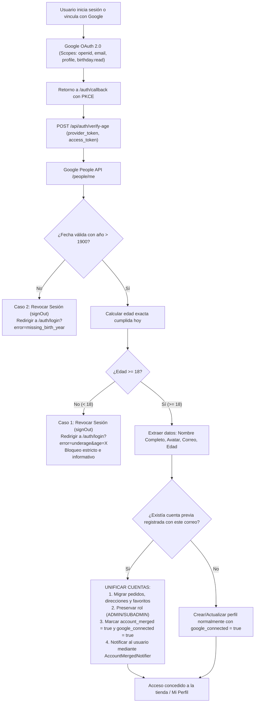

# Arquitectura de Autenticación Google OAuth 2.0, Unificación de Cuentas y Validación de Mayoría de Edad (+18)

**Proyecto:** Lumina Home  
**Rol:** Senior Backend Architect & Cybersecurity Specialist  
**Objetivo:** Integración blindada de inicio de sesión con Google OAuth 2.0, extracción automática de información indispensable (Nombre Completo, Avatar, Correo y Edad), validación estricta de mayoría de edad (+18 años) mediante Google People API, **detección y unificación automática de cuentas registradas previamente por correo manual**, vinculación desde Configuración (`SettingsTab`), mitigación de vulnerabilidades y persistencia en Supabase con Row Level Security (RLS).

---

## 1. Resumen de Archivos y Componentes

| Archivo | Tipo | Descripción |
| :--- | :--- | :--- |
| `src/app/auth/login/page.tsx` | UI / Cliente | Botón oficial **"Continuar con Google"** con vector oficial SVG de 4 colores. Prevención de race conditions (disabled + spinner dinámico). Banners de alerta para menores de edad (`error=underage&age=X`) y cuentas sin año (`error=missing_birth_year`). |
| `src/app/auth/register/page.tsx` | UI / Cliente | Botón oficial **"Continuar con Google"** para acceso unificado. |
| `src/app/auth/callback/page.tsx` | Callback / PKCE | Intercambio de sesión PKCE, llamada al backend `/api/auth/verify-age`, soporte para flujos de vinculación (`linked=true`) y detección de cuentas unificadas (`isMerged`). Revocación inmediata con `signOut()` ante incumplimiento de mayoría de edad (+18). |
| `src/app/api/auth/verify-age/route.ts` | Backend Route Handler | Extracción indispensable de datos (Nombre desde `displayName` / `givenName + familyName`, Avatar, Correo, Edad cumplida). Algoritmo de cálculo de edad. Detección de cuentas preexistentes manuales, migración de pedidos/direcciones/favoritos a la cuenta unificada, preservación de roles (ADMIN/SUBADMIN), y guardado en `public.profiles` y `public.user_profiles`. |
| `src/components/auth/AccountMergedNotifier.tsx` | UI / Modal | Modal interactivo flotante con diseño glassmorphism que notifica al usuario cuando su cuenta previa manual ha sido unificada con Google, asegurándole que sus pedidos, favoritos y direcciones siguen intactos y que ahora puede entrar con contraseña o con Google en 1 clic. |
| `src/components/profile/tabs/SettingsTab.tsx` | UI / Configuración | Nueva sección **"Conexión con Google & Acceso Rápido"**: Muestra el estado actual (Conectado / No vinculado), badge de mayoría de edad (+18) verificada, y botón interactivo para conectar la cuenta actual a Google mediante `supabase.auth.linkIdentity`. |
| `src/components/ui/GoogleVectorIcon.tsx` | UI Component | Vector SVG oficial de Google reutilizable en toda la plataforma. |
| `supabase/migrations/20261018_profiles_account_linking.sql` | Migración SQL | Columnas idempotentes: `google_connected`, `account_merged`, `merged_email`, `auth_provider`, `merged_at`. |
| `supabase/migrations/20261018_profiles_age_verification_18plus.sql` | Migración SQL | Esquema para `public.profiles` con `CONSTRAINT check_minimum_age_18 CHECK (verified_age IS NULL OR verified_age >= 18)` y políticas RLS. |

---

## 2. Flujo de Control: Extracción de Datos, Unificación de Cuentas y Validación (+18)



### Casos de Regla de Negocio:
1. **Extracción Automática de Información Indispensable:**
   - **Nombre:** Se extrae directamente desde Google People API (`names[0].displayName` o combinación `givenName` + `familyName`). Si el usuario no lo tuviera configurado, recurre a los metadatos de OAuth o el prefijo de correo.
   - **Avatar:** URL oficial de foto de perfil (`photos[0].url`).
   - **Edad y Fecha de Nacimiento:** Se calcula la edad exacta cumplida a la fecha de hoy a partir del objeto `date` (`year`, `month`, `day`).
2. **Detección y Unificación Automática de Cuentas (Merge):**
   - Si el usuario se registró previamente mediante formulario manual (Email y Contraseña) con `correo@ejemplo.com`, y posteriormente inicia sesión con el botón *"Continuar con Google"* usando esa misma cuenta:
     - El sistema detecta la existencia previa del correo en Supabase Auth y en `user_profiles`.
     - Unifica ambas identidades manteniendo el historial de pedidos, direcciones de entrega y favoritos.
     - Conserva cualquier rol administrativo (`ADMIN` o `SUBADMIN`) previamente asignado.
     - Despliega el modal de confirmación [`AccountMergedNotifier`](file:///c:/Users/WinterOS/Desktop/Test_Antigravity/lumina-home/src/components/auth/AccountMergedNotifier.tsx) avisando que su cuenta fue unificada y que ahora puede entrar con contraseña o con Google en un solo clic.
3. **Opción en Configuración (`SettingsTab.tsx`):**
   - En **"Mi Perfil"** > **"Configuración"**, la tarjeta **"Conexión con Google & Acceso Rápido"** permite:
     - Si ya está conectada: Muestra el badge verde *"Conectado"*, correo vinculado y confirmación de mayoría de edad (+18) verificada.
     - Si no está conectada: Ofrece el botón **"Conectar con Google"** para vincular la cuenta sin perder la sesión activa utilizando `supabase.auth.linkIdentity`.

---

## 3. Script SQL Completo para Supabase (Listo para Copiar y Pegar)

Pega este bloque en el **SQL Editor** de Supabase y pulsa **Run**:

```sql
-- ==============================================================================
-- Migración Completa: Perfiles, Verificación +18 y Vinculación Google
-- ==============================================================================

-- 1. Crear tabla public.profiles si no existe
CREATE TABLE IF NOT EXISTS public.profiles (
  id UUID REFERENCES auth.users(id) ON DELETE CASCADE PRIMARY KEY,
  email TEXT,
  full_name TEXT,
  avatar_url TEXT,
  birth_date DATE,
  verified_age INT,
  age_verified BOOLEAN DEFAULT false,
  google_connected BOOLEAN DEFAULT false,
  account_merged BOOLEAN DEFAULT false,
  merged_email TEXT,
  auth_provider TEXT DEFAULT 'email',
  merged_at TIMESTAMPTZ,
  updated_at TIMESTAMPTZ DEFAULT now()
);

-- 2. Asegurar todas las columnas de forma idempotente
DO $$ 
BEGIN
  IF NOT EXISTS (SELECT 1 FROM information_schema.columns WHERE table_schema = 'public' AND table_name = 'profiles' AND column_name = 'email') THEN
    ALTER TABLE public.profiles ADD COLUMN email TEXT;
  END IF;

  IF NOT EXISTS (SELECT 1 FROM information_schema.columns WHERE table_schema = 'public' AND table_name = 'profiles' AND column_name = 'full_name') THEN
    ALTER TABLE public.profiles ADD COLUMN full_name TEXT;
  END IF;

  IF NOT EXISTS (SELECT 1 FROM information_schema.columns WHERE table_schema = 'public' AND table_name = 'profiles' AND column_name = 'avatar_url') THEN
    ALTER TABLE public.profiles ADD COLUMN avatar_url TEXT;
  END IF;

  IF NOT EXISTS (SELECT 1 FROM information_schema.columns WHERE table_schema = 'public' AND table_name = 'profiles' AND column_name = 'birth_date') THEN
    ALTER TABLE public.profiles ADD COLUMN birth_date DATE;
  END IF;

  IF NOT EXISTS (SELECT 1 FROM information_schema.columns WHERE table_schema = 'public' AND table_name = 'profiles' AND column_name = 'verified_age') THEN
    ALTER TABLE public.profiles ADD COLUMN verified_age INT;
  END IF;

  IF NOT EXISTS (SELECT 1 FROM information_schema.columns WHERE table_schema = 'public' AND table_name = 'profiles' AND column_name = 'age_verified') THEN
    ALTER TABLE public.profiles ADD COLUMN age_verified BOOLEAN DEFAULT false;
  END IF;

  IF NOT EXISTS (SELECT 1 FROM information_schema.columns WHERE table_schema = 'public' AND table_name = 'profiles' AND column_name = 'google_connected') THEN
    ALTER TABLE public.profiles ADD COLUMN google_connected BOOLEAN DEFAULT false;
  END IF;

  IF NOT EXISTS (SELECT 1 FROM information_schema.columns WHERE table_schema = 'public' AND table_name = 'profiles' AND column_name = 'account_merged') THEN
    ALTER TABLE public.profiles ADD COLUMN account_merged BOOLEAN DEFAULT false;
  END IF;

  IF NOT EXISTS (SELECT 1 FROM information_schema.columns WHERE table_schema = 'public' AND table_name = 'profiles' AND column_name = 'merged_email') THEN
    ALTER TABLE public.profiles ADD COLUMN merged_email TEXT;
  END IF;

  IF NOT EXISTS (SELECT 1 FROM information_schema.columns WHERE table_schema = 'public' AND table_name = 'profiles' AND column_name = 'auth_provider') THEN
    ALTER TABLE public.profiles ADD COLUMN auth_provider TEXT DEFAULT 'email';
  END IF;

  IF NOT EXISTS (SELECT 1 FROM information_schema.columns WHERE table_schema = 'public' AND table_name = 'profiles' AND column_name = 'merged_at') THEN
    ALTER TABLE public.profiles ADD COLUMN merged_at TIMESTAMPTZ;
  END IF;

  IF NOT EXISTS (SELECT 1 FROM information_schema.columns WHERE table_schema = 'public' AND table_name = 'profiles' AND column_name = 'updated_at') THEN
    ALTER TABLE public.profiles ADD COLUMN updated_at TIMESTAMPTZ DEFAULT now();
  END IF;

  -- Columnas en user_profiles si existe la tabla
  IF EXISTS (SELECT 1 FROM information_schema.tables WHERE table_schema = 'public' AND table_name = 'user_profiles') THEN
    IF NOT EXISTS (SELECT 1 FROM information_schema.columns WHERE table_schema = 'public' AND table_name = 'user_profiles' AND column_name = 'google_connected') THEN
      ALTER TABLE public.user_profiles ADD COLUMN google_connected BOOLEAN DEFAULT false;
    END IF;

    IF NOT EXISTS (SELECT 1 FROM information_schema.columns WHERE table_schema = 'public' AND table_name = 'user_profiles' AND column_name = 'account_merged') THEN
      ALTER TABLE public.user_profiles ADD COLUMN account_merged BOOLEAN DEFAULT false;
    END IF;
  END IF;
END $$;

-- 3. Restricción PostgreSQL: verified_age debe ser NULL o >= 18
ALTER TABLE public.profiles DROP CONSTRAINT IF EXISTS check_minimum_age_18;
ALTER TABLE public.profiles ADD CONSTRAINT check_minimum_age_18 
  CHECK (verified_age IS NULL OR verified_age >= 18);

-- 4. Activar Row Level Security (RLS)
ALTER TABLE public.profiles ENABLE ROW LEVEL SECURITY;

-- 5. Políticas de seguridad RLS
DROP POLICY IF EXISTS "Users can view own profile if 18+" ON public.profiles;
DROP POLICY IF EXISTS "Users can update own profile if 18+" ON public.profiles;
DROP POLICY IF EXISTS "Users can insert own profile if 18+" ON public.profiles;

CREATE POLICY "Users can view own profile if 18+"
  ON public.profiles FOR SELECT TO authenticated
  USING (auth.uid() = id AND (verified_age IS NULL OR verified_age >= 18));

CREATE POLICY "Users can update own profile if 18+"
  ON public.profiles FOR UPDATE TO authenticated
  USING (auth.uid() = id AND (verified_age IS NULL OR verified_age >= 18))
  WITH CHECK (auth.uid() = id AND (verified_age IS NULL OR verified_age >= 18));

CREATE POLICY "Users can insert own profile if 18+"
  ON public.profiles FOR INSERT TO authenticated
  WITH CHECK (auth.uid() = id AND (verified_age IS NULL OR verified_age >= 18));

-- 6. Trigger para updated_at
CREATE OR REPLACE FUNCTION public.handle_profiles_updated_at()
RETURNS TRIGGER LANGUAGE plpgsql SECURITY DEFINER SET search_path = public AS $$
BEGIN
  NEW.updated_at = now();
  RETURN NEW;
END;
$$;

DROP TRIGGER IF EXISTS tr_profiles_updated_at ON public.profiles;
CREATE TRIGGER tr_profiles_updated_at
  BEFORE UPDATE ON public.profiles
  FOR EACH ROW EXECUTE FUNCTION public.handle_profiles_updated_at();
```
